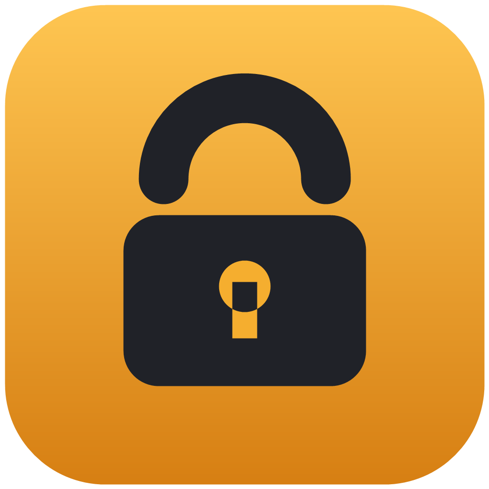

# ArchiveCrack

A small, fast archive password recovery tool for Windows with a native GUI (Dear ImGui + DirectX 11).

Use it only on archives you own or are explicitly authorized to recover.



## Features

- Brute-force mode: custom character set (UTF-8, so any language works), min/max password length, live candidate count.
- Dictionary mode: one password per line.
- Multi-threaded (1-32 threads, defaults to the CPU core count).
- Two engines:
  - **ZipCrypto (native)** - self-contained ZIP decryption with inflate + CRC-32 verification. Measured around 35M candidates/s on a 12-thread machine.
  - **7-Zip backend** - AES-256 ZIP, RAR and 7z archives are verified through a locally installed `7z.exe`.
- Live stats: speed, tested/total candidates, current password, current length, ETA.
- Chinese / English UI, switchable in the header (the default follows the system language).
- Single static executable, no runtime dependencies.

## Usage

Run `ArchiveCrack.exe`, pick an archive, choose a mode, then press Start.
You can also launch it with an archive path pre-filled:

```
ArchiveCrack.exe D:\path\to\archive.zip
```

### Command line

```
ArchiveCrack.exe --cli <archive> <charset> <minLength> <maxLength>
```

Prints `FOUND <password>` and exits with `0` when the password is recovered,
or `NOT FOUND` and exits with `1` otherwise. The 7-Zip backend is used
automatically for non-ZipCrypto archives.

## How it works

For ZipCrypto archives the tool parses the central directory, then for every
candidate it decrypts the 12-byte encryption header and compares the check byte.
A hit is confirmed by decrypting and decompressing the smallest entry and
comparing its CRC-32, so header false positives (about 1 in 256) are rejected.
Enumeration reuses the key state of the shared password prefix, which is what
keeps the throughput high.

## Build

Requirements: MinGW-w64 (g++ with `windres`) and the Dear ImGui 1.90.9 sources.

Put the ImGui sources at `third_party\imgui-1.90.9` (or edit `IMGUI` in `build.bat`), then run:

```
build.bat
```

## Notes

- AES / RAR / 7z archives need [7-Zip](https://www.7-zip.org/) installed; the 7-Zip backend spawns one process per candidate, so it is much slower than the native ZipCrypto engine.
- Very large single-entry archives (over 64 MB) skip the CRC confirmation step.
